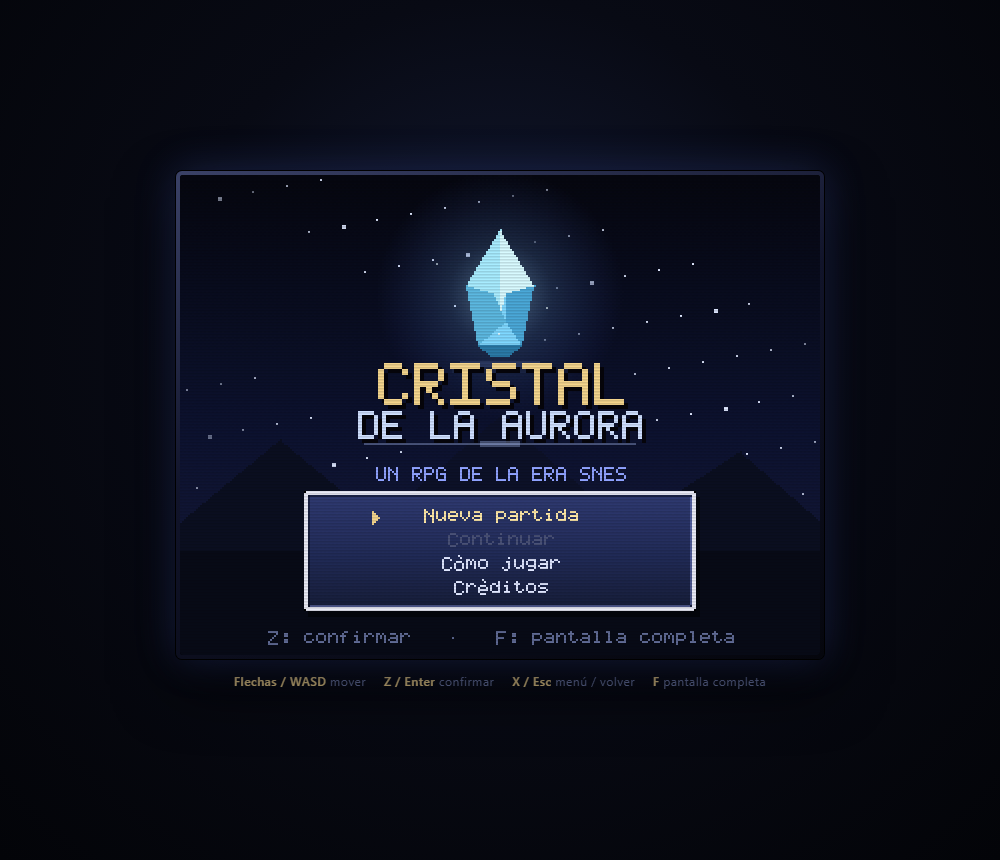

# Cristal de la Aurora

Un JRPG original con estética de **Final Fantasy de SNES**, hecho desde cero con HTML5 Canvas, JavaScript moderno y **cero dependencias**. Todo el arte pixelado, la música chiptune y los efectos de sonido se generan por código.



## Cómo jugar

### Opción rápida (Windows)

Doble clic en **`start.bat`**. Se abre el navegador en `http://127.0.0.1:5123`.

### Manual

```bash
npm start
# o directamente
node server.mjs 5123
```

Abre `http://127.0.0.1:5123`.

> Hace falta un servidor local porque el juego usa módulos ES; abrir `index.html` con doble clic no funciona en la mayoría de navegadores.

### Controles

| Acción | Teclado | Mando |
| --- | --- | --- |
| Mover | Flechas / WASD | Cruceta o stick |
| Hablar / confirmar | Z, Enter o Espacio | Botón A |
| Menú / volver | X o Esc | Botón B |
| Pantalla completa | F | — |
| Quitar líneas de escaneo | L | — |
| Silenciar audio | M | — |

En móvil hay zonas táctiles: arrastra en la mitad izquierda para moverte y toca la esquina inferior derecha para confirmar.

## La aventura

El Cristal de la Aurora se está apagando. El Emperador Vaelor arranca sus fragmentos uno a uno, y en el pueblo de Vallebruma un joven herrero llamado **Kael** siente que el cristal de la plaza vuelve a latir.

- **Kael** — caballero de la aurora. Espada y luz.
- **Lyra** — sacerdotisa. Curación y protección.
- **Bram** — guerrero errante. Daño bruto y gritos de guerra.
- **Nyx** — ladrona de sombras. Rapidez, hielo y drenaje.

La partida dura entre **25 y 40 minutos** y recorre siete mapas: el pueblo, la posada, el bazar, la pradera, dos niveles de cueva y el santuario final. Incluye dos jefes, con una segunda fase para el jefe final.

### Guía rápida (spoilers)

1. Habla con **Lyra** en la plaza para que se una.
2. Habla con el **anciano Ordo** para recibir oro y pociones.
3. Entra en la **posada** y recluta a **Bram** (necesitas haber hablado con Ordo).
4. Sal por el sur, cruza la pradera y entra en la **Cueva de los Ecos**.
5. En el primer nivel de la cueva encontrarás a **Nyx**.
6. En el segundo nivel, el **Caballero Negro** guarda la puerta del santuario.
7. Sube al santuario y enfrenta a **Vaelor**.

Consejo: compra pociones y equipo en el bazar, descansa en la posada y usa el cristal de viaje de la pradera para recuperar fuerzas.

## Sistemas

- **ATB estilo FF IV–VI**: cada combatiente llena su medidor de tiempo según su velocidad. El tiempo se detiene mientras eliges comando.
- **Combate por turnos** con atacar, magia, objetos, defender y huir.
- **Elementos** (fuego, hielo, rayo, luz, oscuridad, tierra) con debilidades y resistencias.
- **Estados**: veneno, defensa, buffs de ataque/defensa/magia/velocidad y resurrección.
- **Progresión**: experiencia, niveles, magias que se aprenden al subir y equipo comprable.
- **Menú de campo**: objetos, magia, equipo, estado y guardado.
- **Tiendas** de compra y venta, posada y cristales que curan al grupo.
- **Guardado local** en `localStorage` (una ranura) y opción de continuar tras un game over.
- **Audio**: sintetizador propio con ondas cuadradas, triangular y ruido; nueve temas originales y más de veinte efectos.

## Estructura del proyecto

```
index.html / styles.css      presentación y lienzo
server.mjs                   servidor estático sin dependencias
start.bat                    lanzador para Windows
src/
  main.js                    bucle principal, escenas, escalado y depuración
  core/                      constantes, azar, entrada, audio, estado, guardado
  data/                      personajes, magias, objetos, enemigos y mapas
  gfx/                       fuente bitmap, sprites, tileset, ventanas y píxel
  logic/                     fórmulas de combate puras (probadas en Node)
  ui/                        caja de diálogo
  scenes/                    campo, batalla, menú, tienda, título, intro, final...
tests/                       validación, simulación de combate y recorrido completo
shots/                       capturas de referencia
```

El juego se dibuja a **320×240** y se escala con píxeles nítidos, igual que una consola de 16 bits. No hay imágenes ni fuentes externas: los sprites se rasterizan con un pequeño motor de píxeles y la tipografía es un bitmap 5×7 con acentos españoles.

## Pruebas

En Windows, doble clic en **`test.bat`**. También puedes ejecutar:

```bash
npm test
```

o directamente con Node, sin npm:

```bash
node tests/audio.mjs
node tests/validate.mjs
node tests/battle-sim.mjs
node tests/battle-flow.mjs
node tests/playthrough.mjs
```

Ejecuta cinco suites sin navegador:

0. **`tests/audio.mjs`** — sintetizador con WebAudio simulado: todas las pistas, percusión y efectos, detectando llamadas inválidas.
1. **`tests/validate.mjs`** — referencias de mapas, tiles, eventos, guiones, magias, objetos, tiendas y accesibilidad (BFS desde el spawn).
2. **`tests/battle-sim.mjs`** — 500 simulaciones por enfrentamiento para comprobar el equilibrio.
3. **`tests/battle-flow.mjs`** — menús de batalla: ataque, magia, objetos, defensa, huida y victoria.
4. **`tests/playthrough.mjs`** — recorrido completo: uniones, puertas, cofres, encuentros, guardado, jefes y final.

## Depuración

El juego acepta parámetros de URL para saltar a escenas concretas:

```
?start=field&map=cueva1&x=13&y=17&party=all&level=5
?start=battle&enemies=vaelor&boss=1&bg=sanctum&level=10&nowait=1&menu=1
?start=menu&party=all&level=6
?start=dialogue | intro | ending | gameover | shop
```

También puedes usar la consola del navegador:

```js
__GAME.level(12);
__GAME.giveAll();
__GAME.warp('santuario', 10, 14);
```

## Créditos

Diseño, código, arte pixelado, música y textos originales creados para este proyecto. Final Fantasy es una marca de Square Enix; este juego es un homenaje original sin relación con ella.
